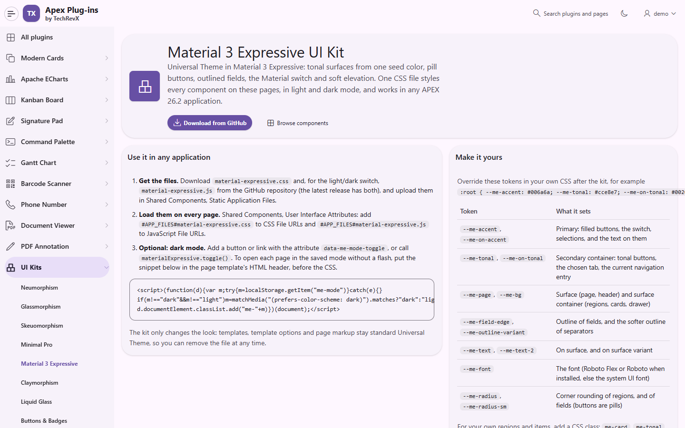
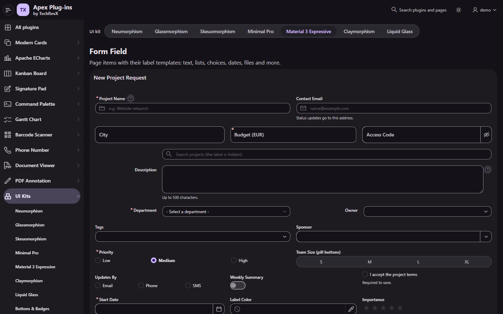
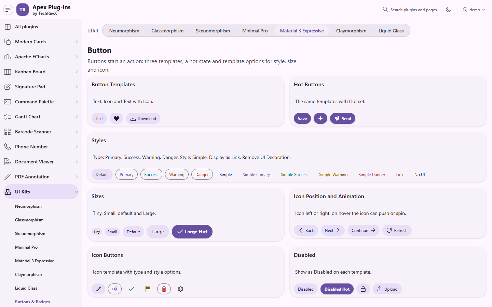
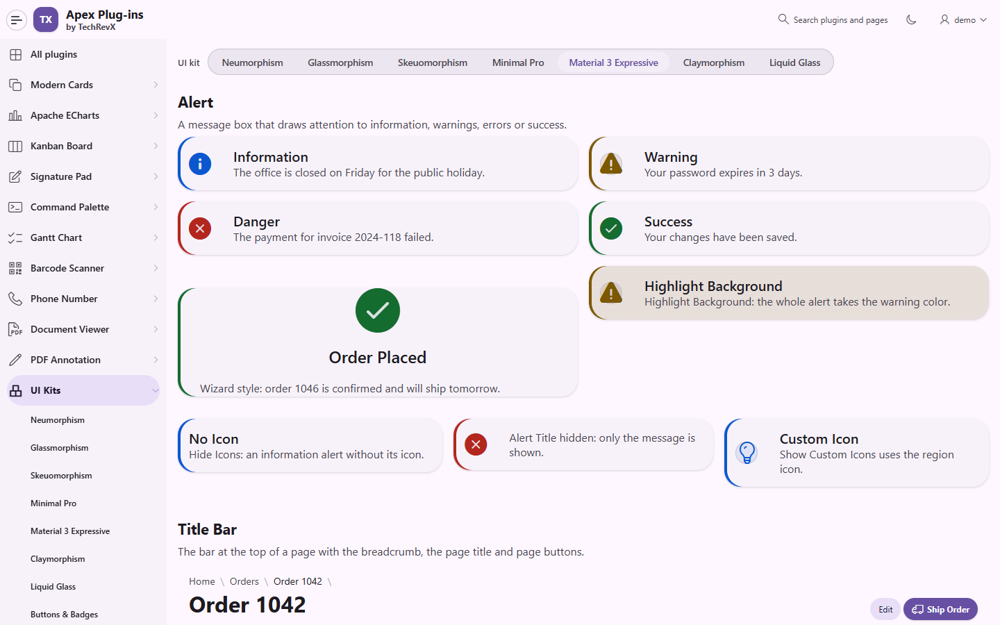
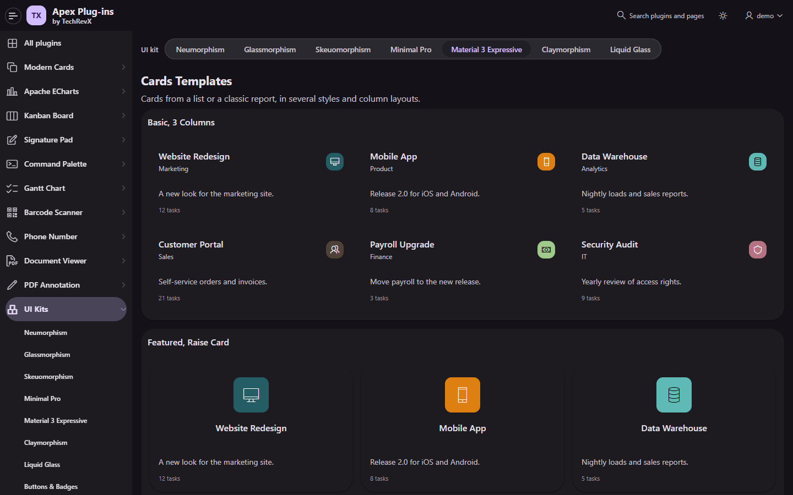
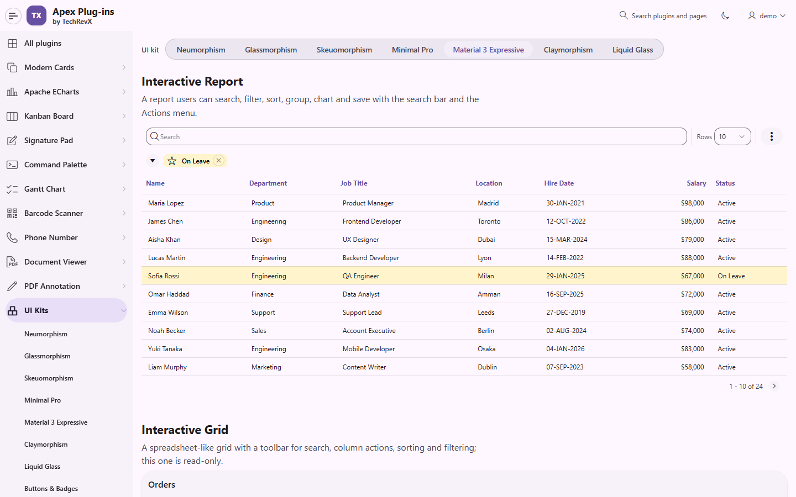
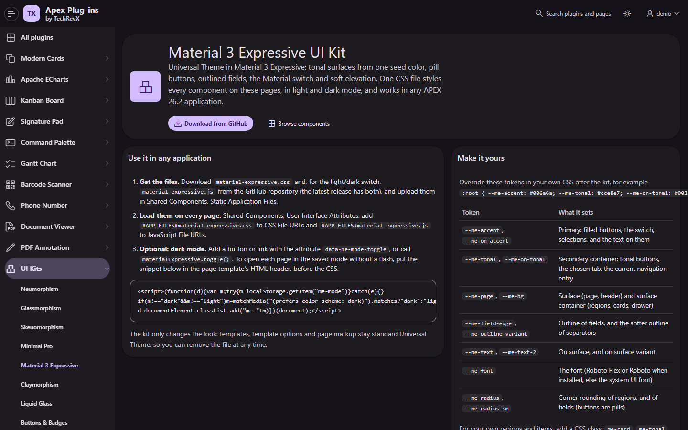
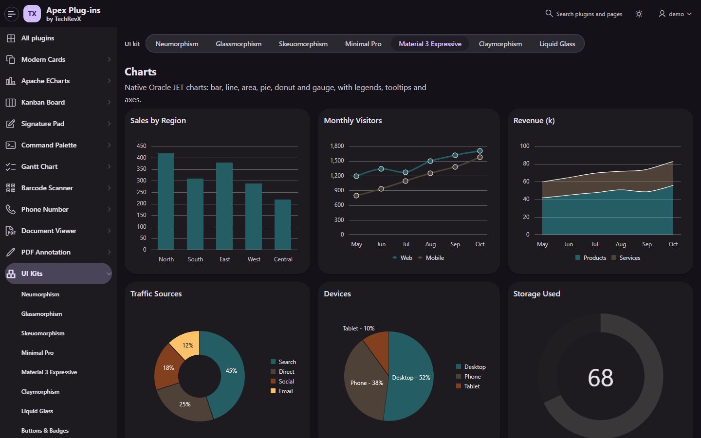

# Material 3 Expressive UI Kit for Oracle APEX

Material 3 Expressive for Oracle APEX Universal Theme: tonal surfaces from one seed color, pill buttons with filled and tonal styles, outlined fields, the Material switch, generous rounded shapes and soft elevation, in light and dark. One CSS file styles every Universal Theme component, in light and dark mode, without changing your pages, templates or template options.

[](https://oracleapex.com/ords/r/aamirkhanz/plugins/material-expressive-ui-kit) &nbsp; Sign in as `demo` with the password `Demo`.



| | |
|---|---|
| **Files** | `material-expressive.css` (the look), `material-expressive.js` (optional light/dark switch) |
| **Version** | 1.0.0 |
| **Built for** | Oracle APEX 26.2, Universal Theme with the Iris theme style (tested); other styles are not tested yet |
| **License** | MIT |

## What it styles

Every component of the Universal Theme reference: Alert, Avatar, Badge, Badges List, Breadcrumb, Button, Button Container, Button Group, Calendar, Card Regions, Card Templates, Carousel, Charts, Classic Report, Collapsible, Column Toggle Report, Comments, Content Block, Content Row, Contextual Info, Flexbox Container, Form Field (every item type and label template), Help Text, Hero, Image, Inline Dialog, Interactive Grid, Interactive Report, Links List, List View, Media List, Menu Bar, Menu Popup, Metric Card, Navigation Bar, PL/SQL Dynamic Content, Reflow Report, Region Display Selector, Standard, Static Content, Tabs Container, Timeline, Title Bar and Tree.

It also styles the page shell (header, side navigation, title bar, footer), modal and inline dialogs, drawers, popups, menus, page messages, tooltips, the date picker, Faceted Search, the rich text editor and select lists.

## Install

1. Download `material-expressive.css` and, for the light/dark switch, `material-expressive.js` from the [latest release](https://github.com/aamirkhanz/apex-material-expressive-ui-kit/releases/latest) or from this repository.
2. In App Builder, go to **Shared Components > Static Application Files** and upload both files.
3. Go to **Shared Components > User Interface Attributes** and add:
   - CSS File URLs: `#APP_FILES#material-expressive.css`
   - JavaScript File URLs: `#APP_FILES#material-expressive.js`

That's all: every page of the application now uses the kit. Remove the two URLs to go back to plain Universal Theme.

## Dark mode



`material-expressive.js` switches between light and dark and remembers the choice (localStorage `me-mode`); until the user chooses, it follows the operating system.

- Add a button or link with the attribute `data-me-mode-toggle`, or call `materialExpressive.toggle()`.
- `materialExpressive.setMode( "light" | "dark" | "auto" )` sets a mode; `materialExpressive.getMode()` returns the current one.
- `<html>` fires `me-modechange` with `detail.mode` after a change, for example to redraw charts.

To open each page in the saved mode without a flash, put this snippet in the page template's HTML header, before the CSS:

```html
<script>(function(d){var m;try{m=localStorage.getItem("me-mode")}catch(e){}
if(m!=="dark"&&m!=="light")m=matchMedia("(prefers-color-scheme: dark)").matches?"dark":"light";
d.documentElement.classList.add("me-"+m)})(document);</script>
```

Without the JavaScript, the kit is light; add the class `me-dark` to `<html>` yourself for dark.

## Make it yours

Override the tokens in your own CSS, loaded after the kit:

```css
:root { --me-accent: #006a6a; --me-accent-text: #006a6a; --me-tonal: #cce8e7; --me-on-tonal: #002020; }
html.me-dark { --me-accent: #4cdada; --me-on-accent: #003737; --me-tonal: #1f4d4d; --me-on-tonal: #cce8e7; }
```

| Token | What it sets |
|---|---|
| `--me-accent`, `--me-on-accent` | Primary: filled buttons, the switch, selections, and the text on them |
| `--me-tonal`, `--me-on-tonal` | Secondary container: tonal buttons, the chosen tab, the current navigation entry |
| `--me-page`, `--me-bg` | Surface (page, header) and surface container (regions, cards, drawer) |
| `--me-field-edge`, `--me-outline-variant` | Outline of fields, and the softer outline of separators |
| `--me-text`, `--me-text-2` | On surface, and on surface variant |
| `--me-font` | The font (Roboto Flex or Roboto when installed, else the system UI font) |
| `--me-radius`, `--me-radius-sm` | Corner rounding of regions, and of fields (buttons are pills) |
| `--me-success`, `--me-warning`, `--me-danger`, `--me-info` | Status colors |

For your own regions, items and HTML, add a CSS class: `me-card`, `me-tonal`, `me-raised`, `me-inset`, `me-flat`, `me-pill` or `me-accent`.

## Screenshots

| | |
|---|---|
|  |  |
|  |  |
|  |  |

## Notes

- **No markup changes.** The kit only overrides Universal Theme's CSS variables and styles its components; your templates and template options stay standard.
- **Accessibility.** Text keeps WCAG AA contrast on the surfaces, fields have a clear edge, keyboard focus always shows a ring, and motion is reduced when the user asks for it.
- **Material 3.** The colors follow the Material 3 baseline scheme (seed #6750a4); generate your own scheme with Google's Material Theme Builder and copy its roles into the tokens.
- **Fonts.** The kit uses Roboto Flex or Roboto when installed and loads no web fonts.
- **Select lists.** In browsers with customizable selects (Chrome and Edge 135 and later) the open list takes the kit's style; other browsers show their native list.
- **Charts.** Chart series keep the colors you set in each chart; the kit styles the region around them.

## License

MIT, see [LICENSE](LICENSE).

## More

Plug-ins and updates for Oracle APEX by [TechRevX](https://www.techrevx.com). More UI kits: [Neumorphism UI Kit](https://github.com/aamirkhanz/apex-neumorphism-ui-kit), [Glassmorphism UI Kit](https://github.com/aamirkhanz/apex-glassmorphism-ui-kit), [Skeuomorphism UI Kit](https://github.com/aamirkhanz/apex-skeuomorphism-ui-kit), [Minimal Pro UI Kit](https://github.com/aamirkhanz/apex-minimal-pro-ui-kit), [Claymorphism UI Kit](https://github.com/aamirkhanz/apex-claymorphism-ui-kit), [Liquid Glass UI Kit](https://github.com/aamirkhanz/apex-liquid-glass-ui-kit).
